# InspiredTax Mobile QA Previews (Temporary Private Repo)

**Phase 0 + Phase 1 Read-Only Comparison:** `v8.36.1` (`3e243808`) vs `v8.37.0` (`2a345342`) vs `ux-review/v4-iter3` (`37674560`)
*(Safe to delete once mobile QA is complete — `InspiredTax_App` was never modified.)*

---

## Tap on Your Phone to Download & Open in Chrome (100% Offline)

Each `.html` file below is **100% self-contained** (all fonts, icons, Chart.js, auto-unlock shim, and Android Chrome offline `localStorage` + `crypto.subtle` fallbacks included).
Tap **Download**, then open the downloaded file from Android **Downloads** in **Chrome**:

| File | Build | What's Inside | Mobile Download |
|---|---|---|---|
| **[`v8.36.1.html`](blob/main/v8.36.1.html)** | `v8.36.1` (`3e243808`) | Pre-M0..M9 baseline · Auto-unlocked **Thandi Mokoena** (2026/27, Premium, PIN `1234`) + floating `QA` pill (Seeded / Onboarding / Lock / Theme) | [**Download v8.36.1.html (2.5 MB)**](https://github.com/inspiredfr/inspiredtax-qa-preview/raw/main/v8.36.1.html) |
| **[`v8.37.0.html`](blob/main/v8.37.0.html)** | `v8.37.0` (`2a345342`) | Shipped M0–M9 + Remediation · Same auto-unlocked persona + floating `QA` pill | [**Download v8.37.0.html (2.8 MB)**](https://github.com/inspiredfr/inspiredtax-qa-preview/raw/main/v8.37.0.html) |
| **[`v4-iter3.html`](blob/main/v4-iter3.html)** | `ux-review/v4-iter3` (`37674560`) | 17-commit Fresh-Eyes UX + IT23 branch · Same auto-unlocked persona + floating `QA` pill | [**Download v4-iter3.html (2.8 MB)**](https://github.com/inspiredfr/inspiredtax-qa-preview/raw/main/v4-iter3.html) |
| **[`visual-gallery-offline.html`](blob/main/visual-gallery-offline.html)** | All 3 builds | Interactive 3-Up swipe gallery + **2-Way pixel wipe slider** (42 embedded `360×740` Dark/Light screenshots) + Phase 0+1 Audit | [**Download visual-gallery-offline.html (5.3 MB)**](https://github.com/inspiredfr/inspiredtax-qa-preview/raw/main/visual-gallery-offline.html) |

> **Tip inside any opened app:** Tap the floating **`QA · <version>`** pill near the bottom-right to switch between **Seeded App (Thandi)**, **Fresh Onboarding Step 1**, **Lock Screen**, and **Dark / Light Theme**.

---

## Phase 0 · SARS Tax Engine Parity (`calcFullTax()`, 2026/27)

| Engine Line | `v8.36.1` | `v8.37.0` | `v4-iter3` | Parity |
|---|---:|---:|---:|:---:|
| Taxable Income | R 955 520.00 | R 955 520.00 | R 955 520.00 | MATCH |
| Tax Before Rebates | R 287 876.20 | R 287 876.20 | R 287 876.20 | MATCH |
| Primary Rebate | R 17 820.00 | R 17 820.00 | R 17 820.00 | MATCH |
| Medical Credits (`s6A` + `s6B`) | R 9 024.00 | R 9 024.00 | R 9 024.00 | MATCH |
| Net Tax Payable | R 261 032.20 | R 261 032.20 | R 261 032.20 | MATCH |
| Provisional P1 Paid | R 24 000.00 | R 24 000.00 | R 24 000.00 | MATCH |
| **Balance Due to SARS** | **R 69 032.20** | **R 69 032.20** | **R 69 032.20** | **100% MATCH** |

---

## Phase 1 · Real `360×740` Mobile DOM & UX Metrics (12 Panels)

| Metric | `v8.36.1` | `v8.37.0` | `v4-iter3` |
|---|---:|---:|---:|
| Runtime Console / Page Errors | 0 | 0 | **0** |
| Horizontal Overflow (`100%` / `150%` zoom) | 0 / 0 | 0 / 0 | **0 / 0** |
| Max Sticky Top Chrome | 293 px | 293 px | **138 px** (`-155 px`) |
| Min Usable Reading Viewport (`740 px` tall) | 393 px | 349 px | **504 px** (`+155 px`) |
| Unmasked Numeric Inputs (OS keyboard pops) | 10 | 18 | **4** (`homeoffice` ×2, `return` ×2) |
| Interactive Elements `< 48×48 px` | 257 | 162 | **158** |

---

## Quick Visual Preview (360×740 Dark — Scroll Right on Phone)

### Dashboard

| `v8.36.1` | `v8.37.0` | `ux-review/v4-iter3` |
|---|---|---|
| 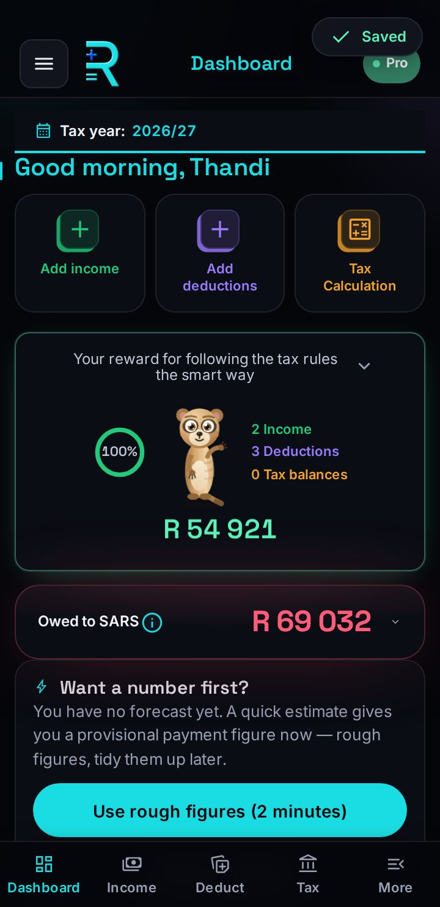 | 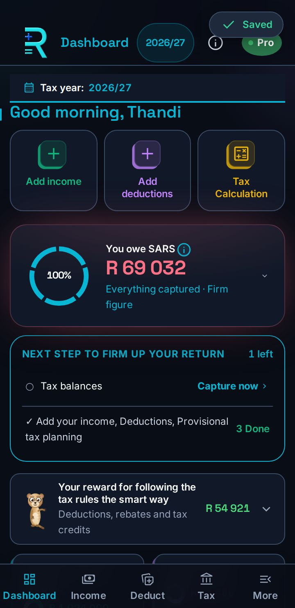 | 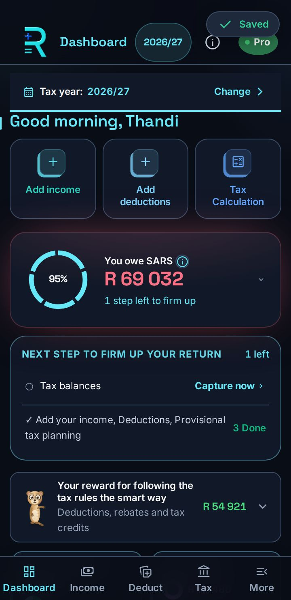 |

### Onboarding Step 1

| `v8.36.1` | `v8.37.0` | `ux-review/v4-iter3` |
|---|---|---|
| 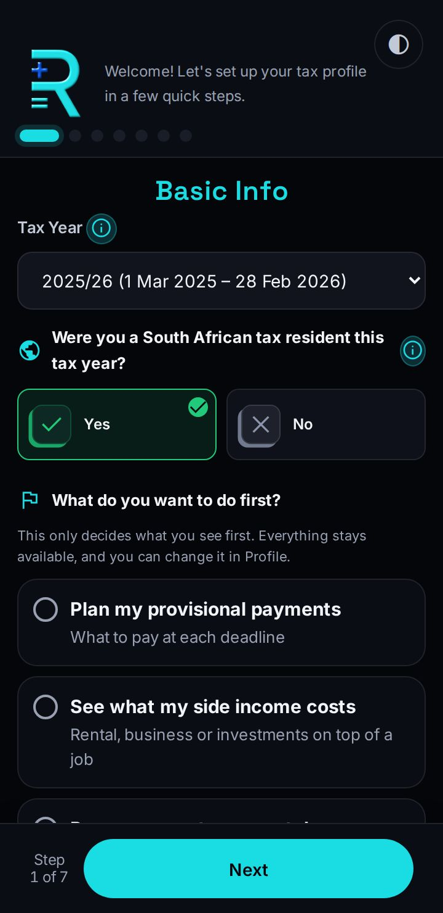 | 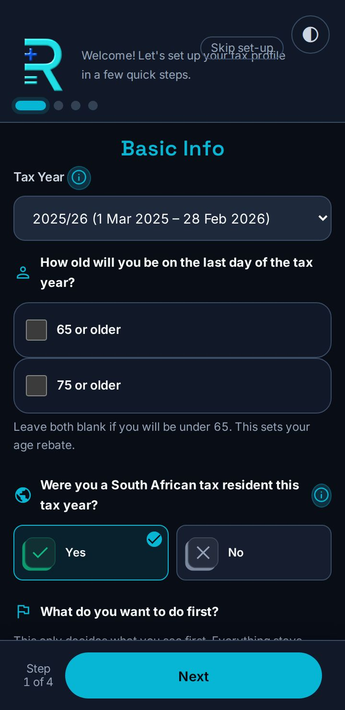 | 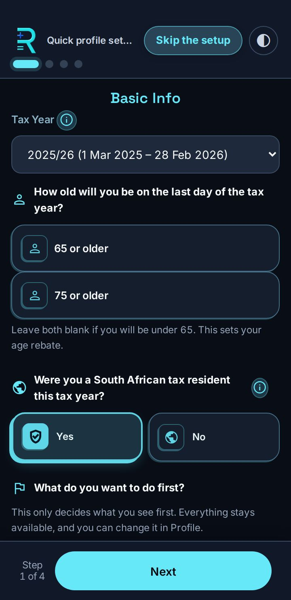 |

### Income Overview

| `v8.36.1` | `v8.37.0` | `ux-review/v4-iter3` |
|---|---|---|
| 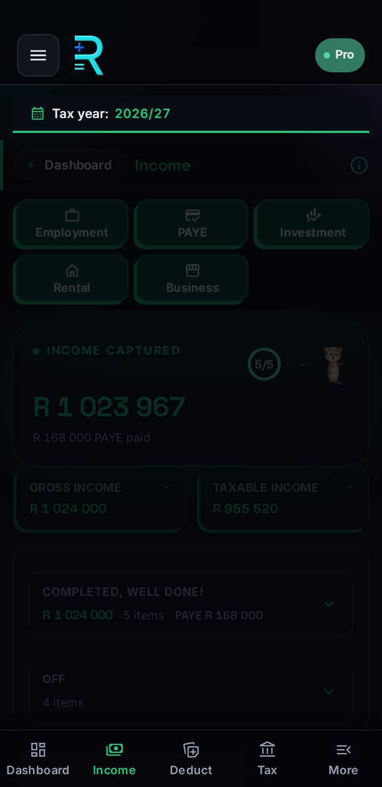 | 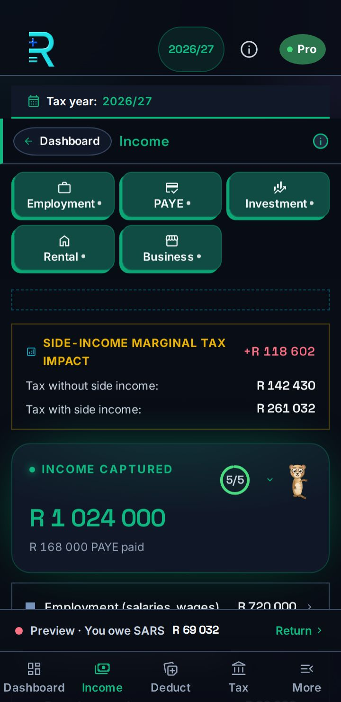 | 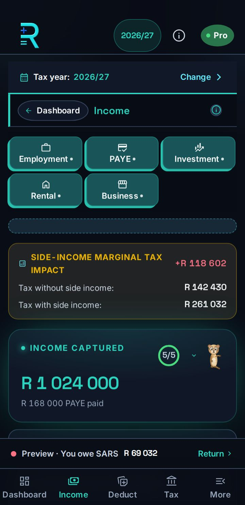 |

### Deductions

| `v8.36.1` | `v8.37.0` | `ux-review/v4-iter3` |
|---|---|---|
| 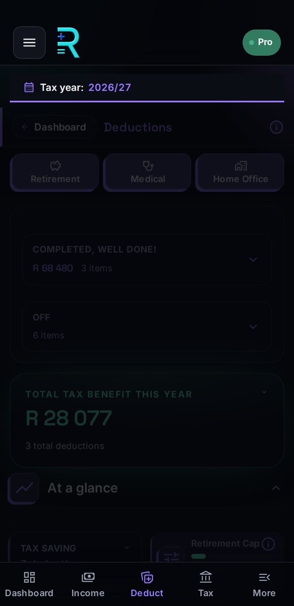 | 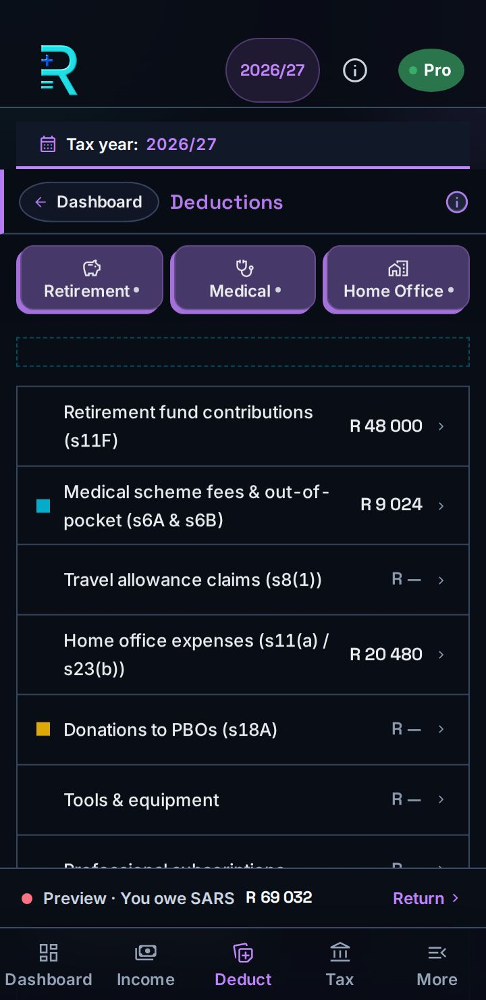 | 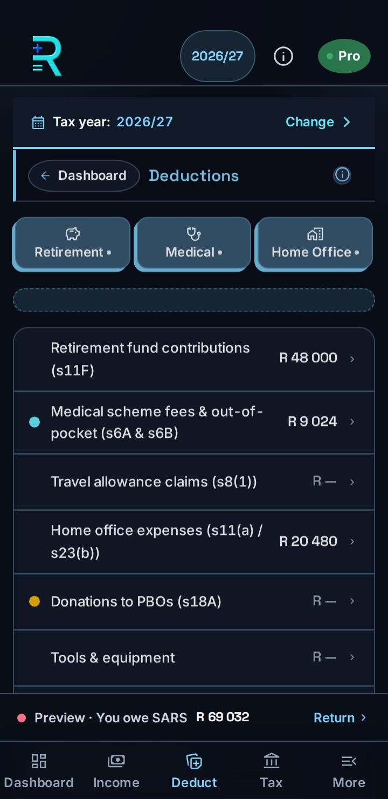 |

### Tax Return (ITA34)

| `v8.36.1` | `v8.37.0` | `ux-review/v4-iter3` |
|---|---|---|
| 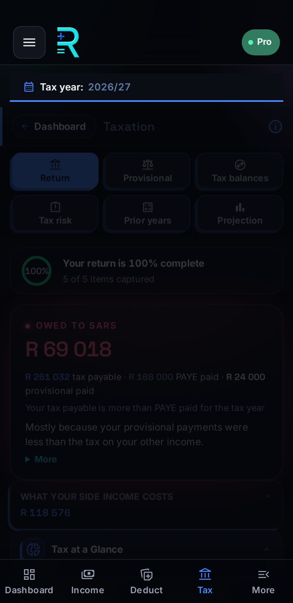 | 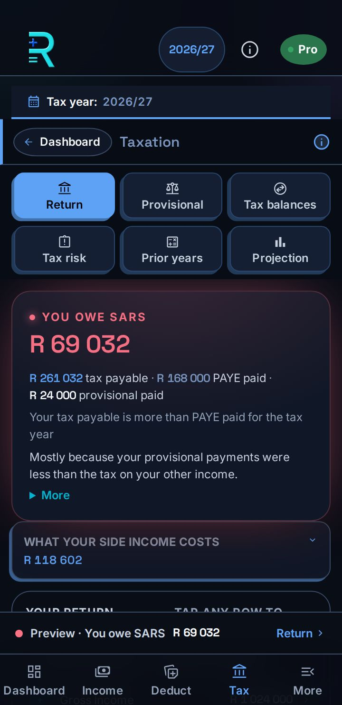 | 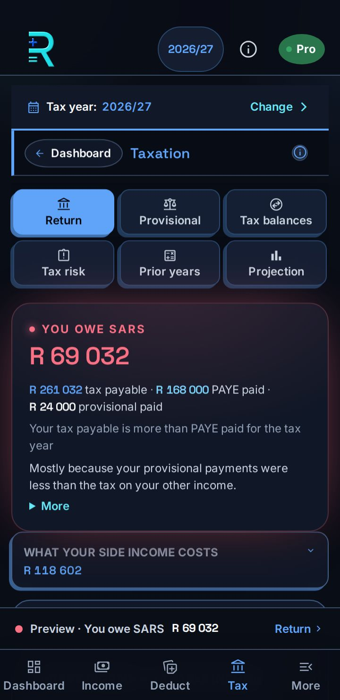 |

### Provisional Tax

| `v8.36.1` | `v8.37.0` | `ux-review/v4-iter3` |
|---|---|---|
| 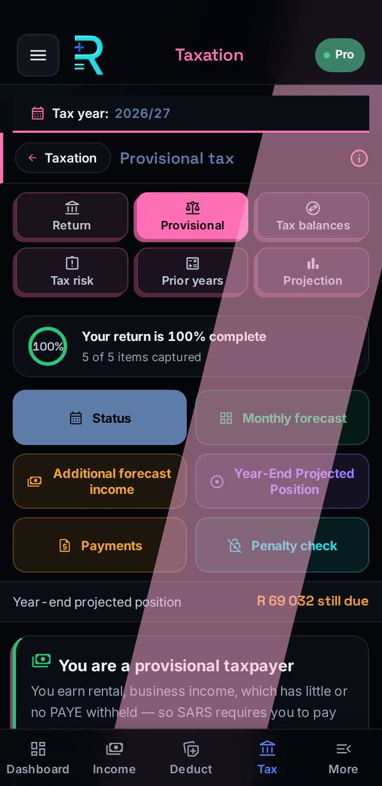 | 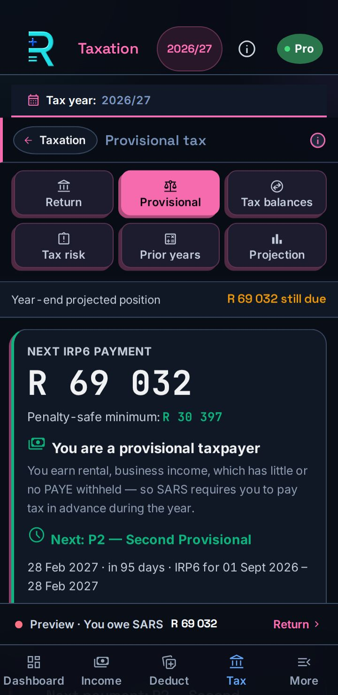 | 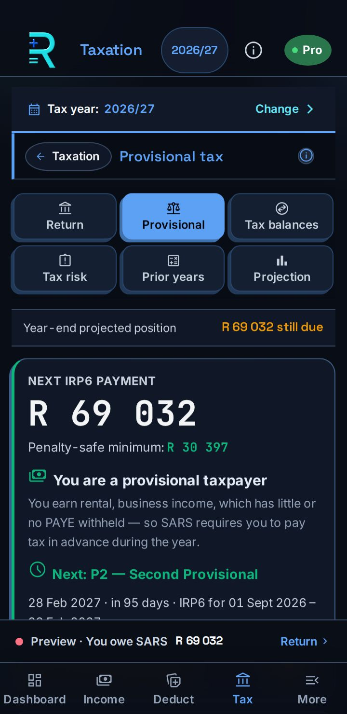 |

### RA Optimise

| `v8.36.1` | `v8.37.0` | `ux-review/v4-iter3` |
|---|---|---|
| 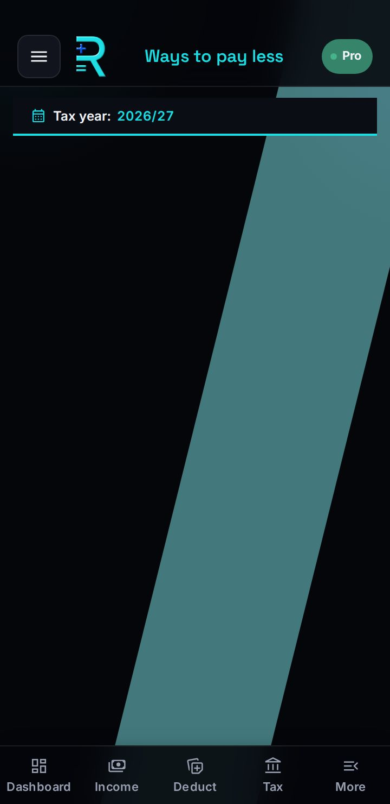 | 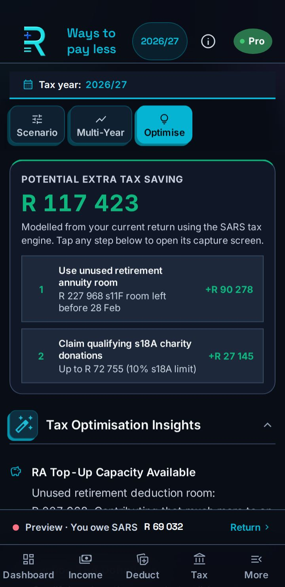 | 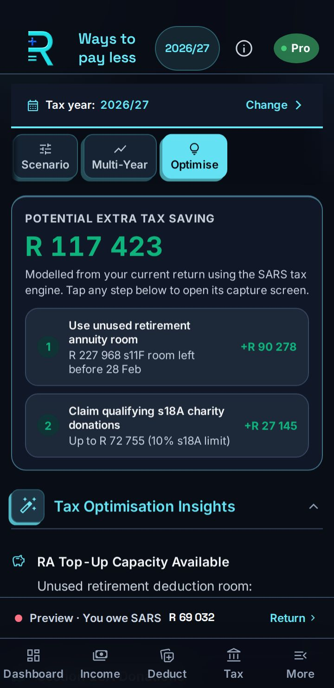 |

*(Light theme captures are inside [`shots/`](tree/main/shots) and [`visual-gallery-offline.html`](https://github.com/inspiredfr/inspiredtax-qa-preview/raw/main/visual-gallery-offline.html).)*
